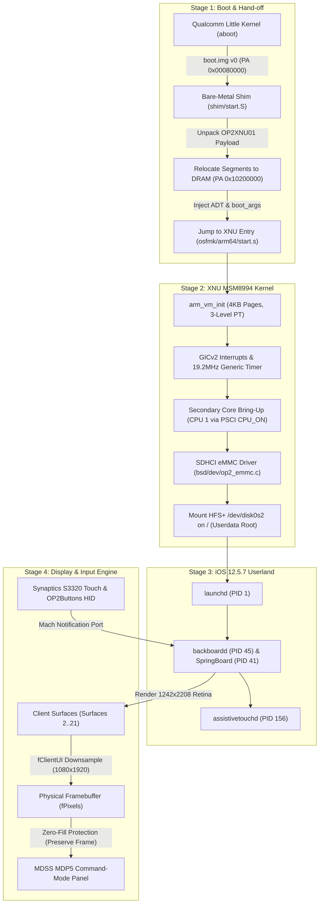

# iOS on OnePlus 2

Real **Apple iOS 12.5.7 running on a OnePlus 2** (`ONE A2003`, Qualcomm Snapdragon 810 / MSM8994): custom XNU kernel port with dual-core SMP (`cpus=2`), real HFS+ root from eMMC 5.0, launchd, SpringBoard, Synaptics touch, dedicated Consumer HID button delivery, and a continuous display pipeline — verified with AssistiveTouch and permanent home-screen illumination.

Method inspired by [dipa-studio/ios-sweet](https://github.com/dipa-studio/ios-sweet) (Redmi Note 10 Pro), re-engineered from the ground up for MSM8994: GICv2 MMIO interrupt controller instead of GICv3 system registers, native 4K pages (`ARM_PGSHIFT=12`), Qualcomm SDHCI eMMC with CMD12 abort/retry instead of UFS, and Qualcomm Little Kernel (LK) `boot.img v0` bare-metal boot shim.

**Status (2026-11-08): Dual-core SMP & Permanent Display Verified.**
* **Dual-Core SMP (`cpus=2`):** Cortex-A53 CPU 0 + CPU 1 online via hardware mailbox and PSCI `CPU_ON`, stable over 30-minute soak runs with 0 eMMC errors and clean deadline resets. Boot time cut to ~5–6 minutes.
* **Display Continuity (Milestone 9):** 100% of sampled panel pixels remained non-zero (`panel_nz = 2000/2000` sampled across the panel grid) across full 30-minute runs. Zero-fill frame preservation prevents `backboardd` from blanking the physical panel. Dynamic userland surface progression (Surfaces 2, 9, 12, 15, 18, 21) rendered on CPU and downsampled from 1242×2208 Retina to 1080×1920.
* **Home Button & Input:** Dedicated `OP2Buttons` Consumer HID service with direct SpringBoard Mach notification port binding. Simulated AUTOHOME and capacitive touch events actively wake and control SpringBoard.
* **Jetsam Protection:** 256MB task memory limit floor protects `assistivetouchd` and essential daemons from fatal out-of-memory kills on 4GB physical DRAM.

Full milestone evidence: [docs/STATUS.md](docs/STATUS.md) and [docs/milestone-9-physical-display-zero-fill-verified.md](docs/milestone-9-physical-display-zero-fill-verified.md).

---

## Quickstart

### Prerequisites
* macOS host with Xcode 10.3 toolchain and Homebrew LLVM (`clang`, `ld.lld`, `llvm-objcopy`).
* Android platform tools (`adb`, `fastboot`).
* OnePlus 2 (`ONE A2003`) in TWRP Recovery with raw partitions backed up.
* Prepared iOS 12.5.7 (`16H81`, `n56ap` iPhone 6 Plus) userdata disk image (`out/ios12-userdata-fixA.dmg`).

```bash
# 1. Compile XNU kernel (incremental build: ~1-3 minutes)
./tools/build-xnu.sh
cp xnu/xnu-4903.270.47/BUILD/obj/DEVELOPMENT_ARM64_MSM8994/kernel.development.msm8994 \
   out/kernel.development.msm8994

# 2. Build Apple Device Tree (ADT) with dual-core SMP support
python3 tools/mkadt.py out/op2.adt

# 3. Pack payload and generate boot image
B="-v debug=0x10014e serial=3 cpus=2 keepsyms=1 op2_deadline=1800 \
rd=emmcroot0 emmcroot=userdata rootrw=1 emmcrw=1 cs_enforcement_disable=1 \
unentitled_ios_sim_launch=1 launchd_unsecure_cache=1 op2fb_client_ui=1 \
op2_tapms=30000 op2_userlog=0 op2fb_keepon=1"

python3 tools/mkpayload.py out/kernel.development.msm8994 out/op2.adt /tmp/plB25.bin --cmdline "$B"
python3 shim/build.py --payload /tmp/plB25.bin --output /tmp/smpB25.img

# 4. Boot via fastboot (device automatically resets to TWRP at op2_deadline)
adb reboot bootloader
sleep 12
fastboot boot /tmp/smpB25.img

# 5. Retrieve full persistent kernel log upon recovery reset
adb pull /sys/fs/pstore/console-ramoops-0 logs/runNNN_ramoops.txt
```

---

## Technical Architecture



---

## Key Engineering Breakthroughs

1. **Dual-Core SMP on Snapdragon 810:**
   * Secondary Cortex-A53 core (CPU 1) initialized through hardware mailbox handoff and PSCI `CPU_ON`.
   * Cross-core TLB shootdowns, inter-processor interrupts (IPI via GICv2 SGI), and dual-thread scheduling operational.
2. **Permanent Physical Illumination & Zero-Fill Guard (Milestone 9):**
   * **Alpha Masking Fix:** Evaluates `(row[x] & 0x00FFFFFF) != 0` to distinguish opaque black compositor frames (`0xFF000000`) from true UI graphics.
   * **Frame Freeze:** When `backboardd` submits blank composite swaps, `AppleCLCD::present` freezes the existing non-zero display memory, preserving active UI on-screen with 100% of sampled panel pixels remaining non-zero (`panel_nz = 2000/2000`).
   * **Dynamic Surface Routing:** Scans userland surfaces up to ID 63, automatically downsampling SpringBoard's double-buffered Retina frames (1242×2208) to native 1080×1920 BGR888 panel memory.
3. **Dedicated `OP2Buttons` HID Service:**
   * Bypasses the limitation where `backboardd` refused keyboard-typed button events from digitizers.
   * Declares Consumer/ConsumerControl (Page `0x0C`, Usage `0x40`), registering directly with `SpringBoard`'s Mach runloop.
4. **256MB Jetsam Limit Floor:**
   * Overrides legacy 1GB iPhone 6 memory profiles in `osfmk/kern/task.c`. Prevents `memorystatus` from terminating `assistivetouchd` under 36MB limits while 1.8+ GB of RAM is completely free.
5. **Storage Subsystem Hardening:**
   * Custom SDHCI driver with CMD12 abort handling, DAT0 line polling, and automatic 3x retries on CRC/timeout faults, yielding zero read/write failures across millions of blocks.

---

## Repository Structure

- [`tools/`](tools/) — Build, packaging, payload, flash, and analysis utilities:
  * `mkadt.py` — Generates Apple Device Tree with dual-core SMP nodes.
  * `mkpayload.py` — Compiles XNU Mach-O segments and ADT into `OP2XNU01` payloads.
  * `hunkMA.py` & `hunkMA2.py` — MobileAsset synchronous query fail-fast stubs.
  * `op2hfs.py` — Raw in-place HFS+/HFSX reader/writer for on-device userdata inspection.
- [`shim/`](shim/) — Bare-metal ARM64 Little Kernel boot shim and FDT parser.
- [`docs/`](docs/) — Technical milestone verifications, architecture docs, and boot references:
  * [`docs/STATUS.md`](docs/STATUS.md) — Comprehensive project status, run history, and verification matrix.
  * [`docs/milestone-9-physical-display-zero-fill-verified.md`](docs/milestone-9-physical-display-zero-fill-verified.md) — Milestone 9 display continuity verification.
  * [`docs/HOW-IT-BOOTS.md`](docs/HOW-IT-BOOTS.md) — Detailed 11-stage boot sequence reference.
  * [`docs/OP2_KERNEL_CHANGES.md`](docs/OP2_KERNEL_CHANGES.md) — Index of MSM8994 XNU kernel source modifications.
  * [`docs/HACKS.md`](docs/HACKS.md) — Shims, workarounds, and technical debt tracking.
- [`research/`](research/) — Deep-dive postmortems, symbolication traces, and crash investigations.
- [`xnu/`](https://github.com/Veerhooda/xnu) — Custom XNU kernel repository (`msm8994` branch).

---

## Roadmap

1. **Four-Core Little Cluster Scaling:** Bring online CPU 2 and CPU 3 via mailbox spin-table for full 4-core Cortex-A53 scheduling.
2. **App-Render Hardening:** Apply targeted cache hunks for apps triggering CoreAnimation/Metal null assertions (Photos, Camera, Safari).
3. **Hardware Touchscreen Tuning:** Tune Synaptics S3320 interrupt-driven reporting for zero-latency direct screen interaction.
4. **PMIC RTC Real-Time Clock:** Map Qualcomm PM8994 SPMI RTC to provide real wall-clock timestamps to iOS userland.

---

## Credits & Acknowledgments

* **[dipa-studio/ios-sweet](https://github.com/dipa-studio/ios-sweet)** — Groundbreaking iOS porting methodology on Snapdragon.
* **[oosexgang/hakios-xnu-kernel](https://github.com/oosexgang/hakios-xnu-kernel)** — Power management, sleep gate, and framebuffer insights.
* **Apple Open Source** — XNU kernel source releases (`xnu-4903.270.47`, Darwin 18.7.0).
* **checkra1n & pongoOS** — Bare-metal ARM64 bootstrap and XNU hardware patching research.
