# How Darwin/XNU Boots on the OnePlus 2 (MSM8994)

This document provides a comprehensive technical breakdown of how Apple's open-source XNU kernel (`xnu-4903.270.47`, Darwin 18.7.0, iOS 12.5.7 generation) boots on the OnePlus 2 (`oneplus2` / `ONE A2003`, Qualcomm Snapdragon 810 / MSM8994) from Qualcomm Little Kernel (LK) through the bare-metal boot shim, kernel VM bootstrap, GICv2 interrupts, eMMC rootfs mounting, launchd, dual-core SMP secondary core spin-up, SpringBoard UI rendering, and automated software warm reboot.

---

## 1. High-Level Boot Pipeline

```mermaid
flowchart TD
    A["Fastboot Host ('fastboot boot out/xnu-boot.img')"] --> B["Qualcomm Little Kernel (aboot) in RAM at 0x0F900000"]
    B --> C["Verify v0 Header & Extract Ramdisk to 0x02000000"]
    B --> D["Jump to Kernel Entry PA 0x00080000 (shim/start.S)"]
    
    subgraph BootShim["Stage 1: Bare-Metal Boot Shim (shim/)"]
        D --> E["Init 64KB Stack at 0x00078000"]
        E --> F["Arm IMEM Recovery Cookie (0xfe87f65c = 0x77665502)"]
        F --> G["Disable Hardware Watchdog (0xf9017000)"]
        G --> H["Parse LK Flattened Device Tree Blob (FDT)"]
        H --> I["Parse OP2XNU01 Payload from Ramdisk"]
        I --> J["Relocate 8 Mach-O Segments to DRAM (0x10200000+)"]
        J --> K["Construct Apple Device Tree (ADT) & struct boot_args"]
        K --> L["Zero ba->Video (Protect Ramoops Console at 0xAC0BE000)"]
        L --> M["Flush Caches (dsb sy, ic iallu, isb sy) & Jump to Kernel Entry"]
    end

    subgraph XNUKernel["Stages 2-6: Kernel & Drivers Bootstrap"]
        M --> N["XNU start.s (CPU 0 Boot Core)"]
        N --> O["arm_init() & arm_vm_init(): 4KB Pages (ARM_PGSHIFT=12)"]
        O --> P["vm_page_bootstrap: ~2,403 MiB Free Physical RAM"]
        P --> Q["GICv2 MMIO Interrupt Controller (0xf9000000/0xf9002000)"]
        Q --> R["ARM Generic Virtual Timer (CNTV_CTL_EL0, 10ms Ticks)"]
        R --> S["OP2PlatformExpert Matches Device Tree Identity 'N56AP'"]
        S --> T["SDHCI eMMC 5.0 Controller Init (CMD12 Abort & 3x Retry)"]
        T --> U["Mount Persistent Writable HFS+ Rootfs from /dev/emmcroot0 (userdata)"]
    end

    subgraph UserlandAndSMP["Stages 7-10: Userland, SMP & Display"]
        U --> V["Launch /sbin/launchd (PID 1) with Code-Sign Bypass"]
        V --> W["Spawn iOS 12.5.7 Daemons (notifyd, securityd, cfprefsd, backboardd)"]
        W --> X["OP2CPU Brings Online CPU 1 via Mailbox & PSCI CPU_ON (0xC4000003)"]
        X --> Y["SpringBoard (PID 41) Launches & Binds Mach Notification Ports"]
        Y --> Z["OP2Buttons Consumer HID Service (0x0C/0x40) Delivers Home Events"]
        Z --> AA["OP2Framebuffer Dynamic Scanout: Downsample 1242x2208 to 1080x1920"]
        AA --> AB["Zero-Fill Preservation: Freeze Frame on Blank Composite Swaps (100% Sampled Pixels Lit: panel_nz=2000/2000)"]
    end

    subgraph Teardown["Stage 11: Automated Software Warm Reset"]
        AB --> AC["op2_deadline (1800s) Reached or Controlled Panic"]
        AC --> AD["Capture Thread Snapshots (op2_snapshot.c) into Ramoops"]
        AD --> AE["Deassert PS_HOLD (0xfc4ab000 = 0) with IMEM Cookie Intact"]
        AE --> AF["Autonomous Warm Reboot Straight into TWRP Recovery"]
    end
```



---

## 2. Boot Stages in Detail

### Stage 0: Qualcomm Little Kernel (LK / `aboot`)
- **Host Execution:** The developer or test harness issues `fastboot boot out/xnu-boot.img`. The boot image is pushed into DRAM without overwriting the on-flash `boot` partition.
- **Android Boot Header Parameters (Version 0):**
  - `page_size`: 4096 bytes
  - `kernel_addr`: `0x00080000` (512 KiB offset in physical RAM)
  - `ramdisk_addr`: `0x01000000` (LK relocates the initrd payload to `0x02000000`)
  - `tags_addr`: `0x00000100`
- **DTB Concatenation & Board Selection:**
  - Qualcomm's 64-bit Little Kernel reads 4 bytes at offset `0x2C` in the kernel binary to determine the offset of appended Device Tree Blobs (DTBs).
  - The build script (`shim/build.py`) calculates the exact padded size of `shim.bin` (aligned to 4 KB) and writes it into offset `0x2C`.
  - The stock OnePlus 2 multi-DTB blob (`dtbs.blob`) is concatenated immediately behind the shim.
  - LK detects magic `0xd00dfeed` at offset `0x2C`, selects the DTB matching `msm8994` hardware (`qcom,msm-id = <207 0x20001>`), appends `/chosen` properties (`linux,initrd-start` and `linux,initrd-end`), and places the DTB pointer in CPU register `x0`.
- **Handoff:** LK branches to `0x00080000` in AArch64 EL1 with `x0 = FDT_PA` (`0x01E00000`).

---

### Stage 1: Bare-Metal Boot Shim (`shim/`)
The boot shim bridges the gap between Qualcomm's Linux/Android boot protocol and Apple's Darwin/XNU `boot_args` protocol.

1. **Stack & Recovery Cookie Setup (`shim/start.S`):**
   - Allocates a dedicated 64 KiB stack at `0x00078000`.
   - Immediately arms the Qualcomm IMEM restart reason register with the TWRP recovery cookie:
     ```asm
     ldr  x1, =0xfe87f65c        // Qualcomm IMEM restart reason address
     ldr  w2, =0x77665502        // RECOVERY_MODE cookie
     str  w2, [x1]
     ```
2. **Watchdog Management (`shim/main.c`):**
   - Disables the Snapdragon 810 hardware watchdog (`0xf9017000`) during early boot to prevent unrecoverable PMIC emergency shutdowns, relying instead on clean software panic resets.
3. **FDT Parsing (`shim/fdt.c`):**
   - Parses the flattened device tree passed in `x0` to locate the `OP2XNU01` payload in the ramdisk between `linux,initrd-start` (`0x02000000`) and `linux,initrd-end`.
4. **Mach-O Segment Relocation (`shim/loader.c`):**
   - Parses the 8 Mach-O segments contained in the `OP2XNU01` payload (`__TEXT`, `__DATA_CONST`, `__TEXT_EXEC`, `__LAST`, `__KLD`, `__DATA`, `__BOOTDATA`, `__LINKEDIT`).
   - Copies each segment into physical DRAM starting at `0x10200000` (`physBase`).
   - Places the serialized Apple Device Tree (ADT) immediately above the highest kernel segment (`0x10C4B000`).
   - Aligns to a 4 KB boundary and initializes Apple's 384-byte `struct boot_args` at `0x10C4D000`.
5. **Console & Display Protection:**
   - Explicitly zeroes `ba->Video` (`v_baseAddr = 0`, `v_width = 0`, `v_height = 0`). This prevents XNU from allocating an 8 MB boot console surface over the physical Ramoops buffer at `0xAC0BE000`.
   - XNU switches cleanly to serial logging, directing `kprintf()` into the Ramoops ring buffer.
6. **Cache Invalidation & Kernel Handoff:**
   - Executes `dsb sy`, `ic iallu`, `isb sy`, loads `x0 = boot_args_pa`, and jumps to the kernel entry address `0x10200000`.

---

### Stage 2: XNU Early VM & Memory Initialization
Control transfers to `start.s` in `xnu-4903.270.47`:

1. **Early VM Bootstrap (`arm_vm_init.c`):**
   - Reads `boot_args`:
     - `virtBase = 0xfffffff007000000`
     - `physBase = 0x10200000`
     - `memSize  = 0x9bd00000` (~2,493 MiB)
   - Configures 3-level page translation tables with a strict 4 KB granule (`ARM_PGSHIFT = 12`).
   - Maps physical memory aperture (`physmap`) and statically linked kernel segments.
2. **Page Size Resolution (Radar 20804515):**
   - Apple's default XNU code defaults to 16 KB software pages on 64-bit devices with > 1 GiB RAM.
   - For `ARM64_BOARD_CONFIG_MSM8994`, `PAGE_SHIFT_CONST` is explicitly pinned to `ARM_PGSHIFT` (12 = 4 KB).
   - `vm_page_bootstrap` initializes **615,168 4 KB pages** (~2,403 MiB free physical memory, **97.89% free pages**).

---

### Stage 3: Interrupt Controller (GICv2) & Hardware Timer
1. **GICv2 Driver (`OP2InterruptController.cpp`):**
   - Maps GIC Distributor (`0xf9000000`) and GIC CPU Interface (`0xf9002000`).
   - Configures Distributor Control (`GICD_CTLR`), enables Group 1 non-secure interrupts, and sets default priorities.
   - CPU Interface registers are initialized (`GICC_CTLR`, `GICC_PMR = 0xFF`, `GICC_BPR = 0x0`).
2. **ARM Generic Virtual Timer Dispatch:**
   - Maps Virtual Timer PPI (INTID 20) in GICv2.
   - Programs `CNTV_CTL_EL0` and `CNTV_TVAL_EL0` for 10 ms periodic ticks (19.2 MHz clock frequency).
   - Interrupt entry in `osfmk/arm64/sleh.c` intercepts INTID 20, dispatches `rtclock_intr()`, re-arms the timer, and acknowledges the GIC via `GICC_EOIR`.

---

### Stage 4: Platform Expert & Device Tree Matching
1. **Device Tree Matching:**
   - `OP2PlatformExpert` extends `IODTPlatformExpert` and matches against the Apple Device Tree product name `"N56AP"` (iPhone 6 Plus profile).
2. **Resource Publication:**
   - Publishes `IORTC` resource to satisfy Mach `inittodr()` without stalling.
   - Bypasses the 30-second `IOBSD` resource wait stall in `IOKitBSDInit.cpp`.
   - Initializes core crypto defensive null-guards and built-in `libpthread-330.250.2`.

---

### Stage 5: SDHCI eMMC 5.0 Controller & Rootfs Mount
1. **Storage Driver (`bsd/dev/op2_emmc.c`):**
   - Maps Qualcomm SDCC 5.0 Host Controller registers at `0xf9824900` and Vendor Core registers at `0xf9824000`.
   - Reads GPT partition table from the internal 64 GB eMMC 5.0 flash.
   - Locates the partition specified by `emmcroot=userdata` and binds `/dev/emmcroot0`.
2. **Hardware Resilience:**
   - Implements hardware `CMD12` abort recovery on timeouts.
   - Polls DAT0 line status before and after block transfers.
   - Automatically executes 3x retries on CRC or timeout faults, achieving 0 errors over millions of blocks.
3. **HFS+ Filesystem Mount:**
   - Invokes built-in Apple `hfs-627.100.6` filesystem driver.
   - Mounts the `userdata` partition as the root filesystem (`/`) in read-write mode (`rootrw=1 emmcrw=1`).

---

### Stage 6: Userland Bootstrap (`launchd`)
1. **Execution of PID 1:**
   - Kernel executes `/sbin/launchd` as process ID 1 with `cs_enforcement_disable=1` and `launchd_unsecure_cache=1`.
2. **Essential System Daemons:**
   - `launchd` inspects `/System/Library/LaunchDaemons/` and spawns core iOS services:
     - `notifyd` (Mach IPC notifications)
     - `fseventsd` (filesystem event logging)
     - `syslogd` (system logging)
     - `securityd` (security infrastructure)
     - `cfprefsd` (CoreFoundation preferences)
     - `backboardd` (graphics event broker and compositor)
     - `SpringBoard` (iOS shell and application manager)

---

### Stage 7: Dual-Core SMP Secondary Core Bring-Up
1. **Secondary CPU Spin-Up (`OP2CPU.cpp`):**
   - Secondary core bring-up is triggered during IOKit platform startup.
   - Kernel executes ARM PSCI SMC call `CPU_ON` (`0xC4000003`) targeting CPU 1 MPIDR (`0x0001`) with entry address `arm_init_secondary`.
   - Hardware mailbox at `0x00080000` synchronizes startup state between CPU 0 and CPU 1.
2. **Secondary Core Initialization (`start.s` & `arm_init.c`):**
   - CPU 1 enables its architectural MMU, caches, and system registers.
   - Sets up dedicated kernel and exception stacks.
   - Configures local GICv2 CPU interface and ARM Generic Timer.
   - Signals ready in the mailbox; Mach preemptive multi-core scheduler begins assigning threads across both cores.
   - Cross-core TLB shootdowns and thread preemption communicate via GICv2 SGI 0.

---

### Stage 8: Display Pipeline & Zero-Fill Frame Preservation
1. **MDSS Framebuffer Pipeline (`OP2Framebuffer.cpp`):**
   - Maps continuous splash scanout memory at `0x03401000` (1080×1920, 32bpp, 4352-byte stride).
2. **Dynamic Surface Scanning:**
   - Scans userland surfaces up to ID 63, dynamically switching scanout source as `backboardd` transitions between surfaces (Surfaces 2, 9, 12, 15, 18, 21).
   - Bilinearly downsamples SpringBoard Retina double-buffered frames (1242×2208) to native 1080×1920.
3. **Zero-Fill Frame Preservation (Milestone 9):**
   - Evaluates pixels with RGB alpha mask `(row[x] & 0x00FFFFFF) != 0` to distinguish opaque black from empty frames.
   - When `backboardd` submits an empty composite frame (e.g. Surface 5 during mode transitions), `AppleCLCD::present` freezes the existing non-zero frame in physical panel memory (`fPixels`).
   - Eliminates screen blanking, with 100% of sampled panel pixels remaining non-zero (`panel_nz = 2000/2000`) over 30-minute runs.
4. **Power State Veto:**
   - Intercepts display power transitions, enforcing `op2fb_keepon=1` to prevent display dimming or hardware sleep.

---

### Stage 9: Input Subsystem: Touch & `OP2Buttons`
1. **Synaptics S3320 Digitizer (`OP2Digitizer.cpp` & `OP2I2C.cpp`):**
   - Initializes S3320 touch controller over I2C bus 4 at address `0x20`.
   - Processes multi-touch coordinate packets and feeds synthetic tap/swipe events (`op2_tapms`) to keep the session active.
2. **Dedicated `OP2Buttons` Consumer HID Service:**
   - Registers as Consumer/ConsumerControl HID usage (Page `0x0C`, Usage `0x40`).
   - Binds directly to `SpringBoard`'s Mach runloop.
   - Dispatches AUTOHOME and capacitive sensor presses to wake the display and navigate to the application icon grid.

---

### Stage 10: Process Protection & Jetsam Floor
1. **Crash Guards (Hunks):**
   - `hunkQC`: QuartzCore commit null-pointer defensive return.
   - `hunkCV`: CoreVideo dictionary null-pointer check in SpringBoard.
2. **256MB Memory Floor (`task.c`):**
   - Overrides default 36 MB footprint limits for iOS system daemons (`assistivetouchd`, `quicklookd`), ensuring zero jetsam kills on 4 GB physical DRAM.

---

### Stage 11: Automated Software Warm Deadline Reset
1. **Deadline Execution (`pe_identify_machine.c`):**
   - Boot-argument `op2_deadline=1800` configures an automated 30-minute test run.
   - Upon timer expiration:
     - `op2_snapshot.c` records thread backtraces, Mach message headers, and dyld image states for `SpringBoard` and `backboardd`.
     - Flushes all pending diagnostic logs to the Ramoops buffer (`0xAC0BE000`).
2. **Warm Reset Trigger:**
   - Arms Qualcomm IMEM restart reason: `*(0xfe87f65c) = 0x77665502` (Recovery Mode).
   - Deasserts Qualcomm power hold line: `*(0xfc4ab000) = 0` (`PS_HOLD = 0`).
3. **Autonomous Reboot to TWRP:**
   - PMIC initiates warm restart while DRAM contents remain preserved.
   - Little Kernel reads the IMEM cookie and reboots directly into TWRP Recovery.
   - Test harness extracts `/sys/fs/pstore/console-ramoops-0` over `adb` with zero user interaction.
