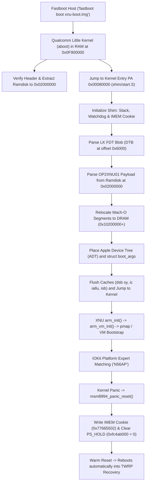

# How Darwin/XNU Boots on the OnePlus 2 (MSM8994)

This document provides a comprehensive technical breakdown of how Apple's open-source XNU kernel (`xnu-4903.270.47`, Darwin 18.7.0, iOS 12.5.7 generation) boots on the OnePlus 2 (`oneplus2` / `ONE A2003`, Qualcomm MSM8994 / Snapdragon 810) from Little Kernel (LK) down to IOKit startup.

---

## 1. High-Level Boot Pipeline



---

## 2. Boot Stages in Detail

### Stage 0: Little Kernel (LK / `aboot`)
- **Fastboot command:** `fastboot boot out/xnu-boot.img` sends an Android boot image (format v0).
- **Header parameters:**
  - `page_size`: 4096 bytes
  - `kernel_addr`: `0x00080000` (512 KiB mark in physical RAM)
  - `ramdisk_addr`: `0x01000000` (LK relocates initrd to `0x02000000`)
  - `tags_addr`: `0x00000100`
- **DTB Appending Mechanism:**
  - Qualcomm's 64-bit Little Kernel reads 4 bytes at offset `0x2C` in the kernel binary to determine the offset of appended Device Tree Blobs (DTBs).
  - The build script (`shim/build.py`) calculates the exact padded size of `shim.bin` (`0x6000` / 24,576 bytes) and writes it into offset `0x2C` of `shim.bin`.
  - The stock 7-DTB blob (`dtbs.blob`) is concatenated immediately behind the shim.
  - LK detects the magic `0xd00dfeed` at offset `0x2C`, selects the DTB matching `msm8994` hardware (`qcom,msm-id = <207 0x20001>` for OnePlus 2), appends the `/chosen` node with `linux,initrd-start` and `linux,initrd-end`, and places the pointer in CPU register `x0`.
- **LK Entry Point:**
  - LK branches to `0x00080000` in AArch64 EL1 with `x0 = FDT_PA` (`0x01E00000`).

---

### Stage 1: Bare-Metal Boot Shim (`shim/`)
The boot shim bridges the gap between Qualcomm's Linux/Android boot protocol and Apple's Darwin/XNU `boot_args` protocol.

1. **`shim/start.S`**:
   - Sets up a standalone 64 KiB stack at `0x00078000`.
   - Immediately writes the IMEM recovery cookie:
     ```asm
     ldr  x1, =0xfe87f65c        // Qualcomm IMEM restart reason address
     ldr  w2, =0x77665502        // RECOVERY_MODE cookie
     str  w2, [x1]
     ```
   - Passes control to `shim/main.c`.

2. **Watchdog Arming (`shim/main.c`)**:
   - The Snapdragon 810 hardware watchdog (`qcom,wdt@f9017000`) is configured:
     - Clock: `32,765 Hz`
     - `WDT0_BARK_TIME (0x10)` = 30 seconds
     - `WDT0_BITE_TIME (0x14)` = 35 seconds
     - `WDT0_EN (0x08)` = 1
     - `WDT0_RST (0x04)` = 1
   - If XNU hangs before panic or during early bring-up, the hardware watchdog bites in 35 seconds, triggering an automated warm reset straight into TWRP.

3. **FDT Parsing (`shim/fdt.c`)**:
   - Traverses the flattened device tree passed in `x0` to locate `/chosen`:
     - `linux,initrd-start` (`0x02000000`)
     - `linux,initrd-end` (`0x029B8970`)

4. **Payload Relocation (`shim/loader.c`)**:
   - The payload format (`OP2XNU01`) packaged by `tools/mkpayload.py` contains:
     - 8 Mach-O segments (`__TEXT`, `__DATA_CONST`, `__TEXT_EXEC`, `__LAST`, `__KLD`, `__DATA`, `__BOOTDATA`, `__LINKEDIT`).
     - Relocates each segment from the ramdisk into physical DRAM starting at `0x10200000` (`physBase`).
     - Places the Apple Device Tree (ADT) immediately above the highest kernel segment (`0x10C4B000`).
     - Aligns to a 4 KB boundary and initializes Apple's 384-byte `struct boot_args` at `0x10C4D000`.

---

### Stage 2: Display & Console Protection
- **Problem:** If video console scanout is passed to XNU with `-v`, XNU allocates an 8 MB rendering surface directly at `Video.v_baseAddr`. On MSM8994, the ramoops buffer sits at `0xAC0BE000`, and writing video memory there corrupts the crash log.
- **Solution:** `shim/loader.c` explicitly zeroes `ba->Video` (`v_baseAddr = 0`, `v_width = 0`, `v_height = 0`).
- **Effect:** XNU detects `v_baseAddr == 0` and prints:
  ```text
  initialize_screen: b=00000000, w=00000000, h=00000000, r=00000000, d=00000000
  initialize_screen: No video - forcing serial mode
  ```
- Kernel `kprintf()` logs are routed cleanly through `osfmk/arm/pe_kprintf.c` directly into the 256 KiB Ramoops ring buffer at `0xAC0BE000`.

---

### Stage 3: XNU Initialization & Memory Management
When control transfers to `start.s` in `xnu-4903`:

1. **Early VM Initialization (`arm_vm_init.c`)**:
   - Reads `boot_args`:
     - `virtBase = 0xfffffff007000000`
     - `physBase = 0x10200000`
     - `memSize  = 0x9bd00000` (~2,493 MiB)
   - Configures 3-level page tables with 4 KB granule (`ARM_PGSHIFT = 12`).
   - Maps physical memory aperture (`physmap`) and statically linked kernel segments.

2. **Page Size Resolution (`radar_20804515` Resolution)**:
   - *Original Apple behavior:* For ARM64 devices with `memSize > 1 GiB`, XNU defaulted to 16 KB software pages (`PAGE_SHIFT_CONST = 14`).
   - *MSM8994 Board Configuration:* Because Cortex-A57/A53 ARMv8.0 uses 4 KB translation tables and we target native 4 KB pages, `osfmk/arm/arm_init.c` pins `PAGE_SHIFT_CONST = ARM_PGSHIFT` (12 = 4 KB) under `ARM64_BOARD_CONFIG_MSM8994`.
   - Result:
     ```text
     [MEM_DEBUG] gPhysBase=0x10200000, gPhysSize=0x9bd00000, page_shift=12, page_size=4096
     vm_page_bootstrap: 602210 free pages, 12958 wired pages
     ```
   - Total managed pages: **615,168 4 KB pages** (2,403 MiB managed + 90 MiB static/stolen = 2,493 MiB physical DRAM, **97.89% free pages**).

---

### Stage 4: Panic & Automated Software Warm Reset
1. **IOKit Platform Expert Panic**:
   - Because open-source XNU does not bundle Apple's closed-source `AppleARMPE` kext, IOKit halts at:
     ```text
     panic(cpu 0 caller 0xfffffff007757194): "Unable to find driver for this platform: \"N56AP\".\n"
     ```
2. **Panic Handler & Automated Warm Reset**:
   - With `debug=0x10014e`, XNU's panic routine invokes `panic_suspend()` / `PEHaltRestart(kPERestartCPU)`.
   - In `osfmk/arm64/machine_routines.c`, `msm8994_panic_reset()` is called:
     ```c
     /* 1. Arm IMEM restart reason for recovery */
     *(volatile uint32_t *)phystokv(0xfe87f65c) = 0x77665502; // RECOVERY_MODE

     /* 2. Pull MSM8994 PS_HOLD low to trigger PMIC warm reset */
     *(volatile uint32_t *)phystokv(0xfc4ab000) = 0;
     ```
3. **Recovery Reboot**:
   - The Qualcomm PMIC performs a hardware reset while DRAM contents remain refreshed.
   - Little Kernel inspects `0xfe87f65c`, reads `0x77665502`, and boots straight into TWRP Recovery.
   - The host retrieves `/sys/fs/pstore/console-ramoops-0` over `adb` with zero button presses or battery disconnects.
